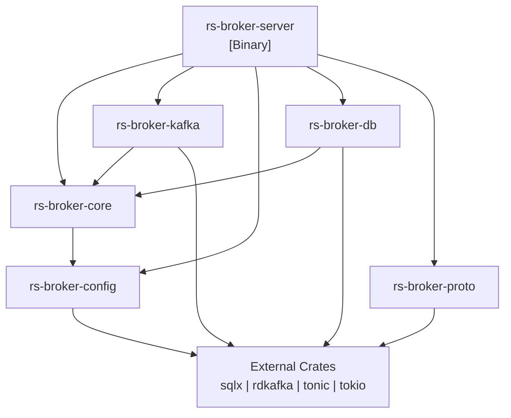

# rs-broker Project Structure

## Overview

This document defines the Rust module structure and crate organization for the rs-broker microservice. The project follows a modular architecture with clear separation of concerns.

## Crate Organization

The project is organized as a Cargo workspace with multiple crates:

```
rs-broker/
├── Cargo.toml                    # Workspace root
├── crates/
│   ├── rs-broker-server/         # Main server binary
│   ├── rs-broker-core/           # Core business logic
│   ├── rs-broker-proto/          # Generated protobuf code
│   ├── rs-broker-db/             # Database layer
│   ├── rs-broker-kafka/          # Kafka integration
│   └── rs-broker-config/         # Configuration management
├── proto/
│   └── rs_broker.proto           # gRPC service definitions
├── migrations/                    # Database migrations
├── docs/                          # Documentation
└── tests/                         # Integration tests
```

## Workspace Cargo.toml

```toml
[workspace]
resolver = "2"
members = [
    "crates/rs-broker-server",
    "crates/rs-broker-core",
    "crates/rs-broker-proto",
    "crates/rs-broker-db",
    "crates/rs-broker-kafka",
    "crates/rs-broker-config",
]

[workspace.package]
version = "0.3.1"
edition = "2021"
rust-version = "1.75"
authors = ["Bouroo Team"]
license = "MIT"

[workspace.dependencies]
# Async runtime
tokio = { version = "1.35", features = ["full"] }
tokio-stream = "0.1"
futures = "0.3"

# gRPC
tonic = "0.10"
tonic-build = "0.10"
prost = "0.12"
prost-types = "0.12"

# HTTP/Web
axum = "0.7"
tower = "0.4"
tower-http = { version = "0.5", features = ["trace", "cors"] }

# Database
sqlx = { version = "0.7", features = ["runtime-tokio", "tls-rustls", "json", "chrono", "uuid"] }

# Kafka
rdkafka = { version = "0.36", features = ["tokio", "cmake-build"] }

# Serialization
serde = { version = "1.0", features = ["derive"] }
serde_json = "1.0"

# Configuration
config = "0.14"
dotenvy = "0.15"

# Observability
tracing = "0.1"
tracing-subscriber = { version = "0.3", features = ["env-filter", "json"] }

# Error handling
thiserror = "1.0"
anyhow = "1.0"

# Utilities
uuid = { version = "1.6", features = ["v4", "serde"] }
chrono = { version = "0.4", features = ["serde"] }
async-trait = "0.1"

# Internal crates
rs-broker-core = { path = "crates/rs-broker-core" }
rs-broker-proto = { path = "crates/rs-broker-proto" }
rs-broker-db = { path = "crates/rs-broker-db" }
rs-broker-kafka = { path = "crates/rs-broker-kafka" }
rs-broker-config = { path = "crates/rs-broker-config" }
```

## Crate Details

### 1. rs-broker-server

Main server binary that wires everything together.

```
crates/rs-broker-server/
├── Cargo.toml
└── src/
    ├── main.rs              # Entry point (composition root)
    ├── lib.rs
    ├── app.rs               # App builder + consumer/publisher/refresh loops
    ├── adapters/
    │   └── callback.rs      # GrpcSubscriberNotifier + ChannelPool (delivery port adapter)
    ├── grpc/
    │   ├── mod.rs
    │   └── service.rs       # gRPC interface adapter (delegates to core use cases)
    ├── http/
    │   ├── mod.rs           # /api/v1 router over the shared RsBrokerService
    │   ├── routes.rs        # REST handlers (same *_inner methods as gRPC)
    │   ├── dto.rs           # serde DTOs + proto conversions
    │   ├── error.rs         # tonic::Status -> HTTP error mapping
    │   └── sse.rs           # SSE event stream (SubscribeEvents parity)
    └── metrics.rs           # Prometheus metrics registry
```

**Dependencies:**
- All internal crates (composition root)
- tonic, axum, tower
- tracing

**Purpose:**
- Interface-adapter layer: gRPC/HTTP presentation, proto<->DTO conversion
- Compose the concrete adapters (sqlx repos, Kafka sink, gRPC notifier)
  and inject the feature ports at startup
- Initialize, wire up all components, graceful shutdown

### 2. rs-broker-core

Core business logic for inbox/outbox patterns.

```
crates/rs-broker-core/
├── Cargo.toml
├── src/
│   ├── lib.rs                # Crate root: declares `shared` and `features`
│   ├── shared/
│   │   ├── error.rs          # Core error type (framework-free)
│   │   └── topic.rs          # MQTT-standard topic pattern matching
│   └── features/
│       ├── publishing/       # The outbox write path
│       │   ├── domain.rs     # OutboxMessage + status ladder + PublishFailureDecision
│       │   ├── accept.rs     # AcceptMessage use case (validation + insert)
│       │   ├── manager.rs    # Outbox bookkeeping use case
│       │   ├── publisher.rs  # Background drain use case (over ports)
│       │   ├── retry.rs      # Retry policy value
│       │   └── ports.rs      # OutboxRepository + MessageSink ports
│       ├── consuming/        # The inbox ingest path
│       │   ├── domain.rs     # InboxMessage + transitions
│       │   ├── manager.rs    # InboxManager
│       │   ├── dispatcher.rs # Consumed-message dispatch with pattern cache
│       │   ├── dedup.rs      # Deduplication (atomic check_and_mark)
│       │   └── ports.rs      # InboxRepository port
│       ├── subscription/     # Subscriber registry + matching
│       │   ├── domain.rs     # Subscriber.matches_topic()
│       │   ├── registry.rs   # SubscriberRegistry use case
│       │   └── ports.rs      # SubscriberRepository port
│       ├── delivery/         # Fan-out to subscribers
│       │   ├── dispatcher.rs # Circuit breaker + bounded concurrent fan-out
│       │   └── ports.rs      # SubscriberNotifier + transport-free DTOs
│       └── dead_letter/      # DLQ routing and reprocessing
│           ├── domain.rs     # DlqMessage
│           ├── handler.rs    # DlqHandler use case
│           └── ports.rs      # DlqRepository port
├── tests/
│   └── architecture.rs        # Executable gate over the cargo dependency DAG
└── benches/                  # Targets the same features (unchanged names)
    ├── lib.rs                # Dedup, dispatch, pattern, registry benchmarks
    ├── fan_out.rs # Sequential vs concurrent fan-out
    ├── dlq.rs
    ├── outbox_manager.rs
    ├── outbox_publisher.rs
    └── retry.rs
```

**Dependencies (no infrastructure):** none of rs-broker-db / rs-broker-kafka /
rs-broker-proto / sqlx / tonic / rdkafka. Only `rs-broker-config` plus
serde/uuid/chrono/tokio/tracing/async-trait — enforced by `cargo tree -p
rs-broker-core` (the compiler rejects any infra import: no `?` on out-of-layer
errors can compile).

**Purpose:**
- Own the domain entities and their behaviour (status ladders, matching,
  retry->DLQ->failed decision)
- Own the use cases (accept publish, drain outbox, ingest inbox, fan out,
  DLQ reprocess)
- Declare the ports that infrastructure must implement

### 3. rs-broker-proto

Generated protobuf code and types.

```
crates/rs-broker-proto/
├── Cargo.toml
├── build.rs                 # Code generation script
└── src/
    ├── lib.rs
    └── rsbroker.rs          # Generated code (gitignored)
```

**Dependencies:**
- tonic, prost

**Purpose:**
- Generate Rust types from proto
- Export gRPC client/server traits

### 4. rs-broker-db

Database layer with database-agnostic support.

```
crates/rs-broker-db/
├── Cargo.toml
└── src/
    ├── lib.rs
    ├── pool.rs              # Connection pool management (frameworks & drivers)
    ├── outbox/
    │   ├── mod.rs
    │   └── repository.rs    # SqlxOutboxRepository: implements core's port
    ├── inbox/
    │   ├── mod.rs
    │   └── repository.rs    # SqlxInboxRepository: implements core's port
    ├── subscriber/
    │   ├── mod.rs
    │   └── repository.rs    # SqlxSubscriberRepository: implements core's port
    ├── dlq/
    │   ├── mod.rs
    │   └── repository.rs    # SqlxDlqRepository: implements core's port
    └── migration.rs         # Migration utilities
```

**Dependencies:**
- rs-broker-core (adapter -> inward; provides the entities and repo ports)
- sqlx (with postgres/mysql features)
- serde, chrono, uuid

**Purpose:**
- Database connection management and migrations
- SQLx row mapping (`*Row` structs) and queries — the *only* SQL in the system
- Implements `rs-broker-core` feature ports; entities live in the feature layer

### 5. rs-broker-kafka

Kafka producer and consumer integration.

```
crates/rs-broker-kafka/
├── Cargo.toml
└── src/
    ├── lib.rs
    ├── config.rs            # Kafka configuration
    ├── producer/
    │   ├── mod.rs
    │   └── client.rs        # Kafka producer wrapper
    ├── consumer/
    │   ├── mod.rs
    │   └── client.rs        # Kafka consumer wrapper
    ├── headers.rs           # Header utilities
    └── error.rs             # Kafka errors
```

**Dependencies:**
- rdkafka
- tokio, futures
- rs-broker-core (adapter -> inward; implements publishing's MessageSink port)
- rs-broker-config

**Purpose:**
- Kafka producer/consumer drivers
- `KafkaMessageSink` adapter implementing `publishing::ports::MessageSink`
- Header manipulation utilities
- (The `rs-broker-proto` types cross the boundary in the server, not here.)

### 6. rs-broker-config

Configuration management.

```
crates/rs-broker-config/
├── Cargo.toml
└── src/
    ├── lib.rs
    ├── settings.rs          # Main settings structure
    ├── server.rs            # Server configuration
    ├── database.rs          # Database configuration
    ├── kafka.rs             # Kafka configuration
    ├── grpc.rs              # gRPC configuration
    └── retry.rs             # Retry policy configuration
```

**Dependencies:**
- config, dotenvy
- serde, serde_json

**Purpose:**
- Load configuration from files and env
- Provide typed configuration structs
- Validate configuration values

## Module Dependency Graph



This graph is enforced at build time by
`crates/rs-broker-core/tests/architecture.rs`, which reads the same dependency
DAG from `cargo metadata` and fails the build on a reversed edge.

## Feature Flags

### Workspace Features

```toml
# In workspace Cargo.toml
[workspace.features]
default = ["postgres", "tracing"]
postgres = ["sqlx/postgres"]
mysql = ["sqlx/mysql"]
tracing = ["tracing-subscriber/json"]
```

### Crate-Specific Features

```toml
# In rs-broker-db/Cargo.toml
[features]
default = ["postgres"]
postgres = ["sqlx/postgres"]
mysql = ["sqlx/mysql"]
```

## Source File Structure

```
rs-broker/
├── Cargo.toml
├── Cargo.lock
├── .gitignore
├── LICENSE
├── README.md
│
├── crates/
│   ├── rs-broker-server/           # Composition root + transport adapters
│   │   ├── Cargo.toml
│   │   ├── src/
│   │   │   ├── main.rs              # Binary entry point
│   │   │   ├── lib.rs
│   │   │   ├── app.rs               # App builder + consumer/publisher loops
│   │   │   ├── metrics.rs
│   │   │   ├── adapters/            # Driven adapter: gRPC subscriber notifier
│   │   │   ├── grpc/                # Driving adapter: gRPC service
│   │   │   └── http/                # Driving adapter: REST + SSE
│   │   ├── tests/                   # gRPC, REST/SSE, and app e2e suites
│   │   │   ├── integration_test.rs
│   │   │   ├── http_api_test.rs
│   │   │   ├── app_e2e_test.rs
│   │   │   └── common/mod.rs        # Shared TestHarness
│   │   └── benches/
│   │
│   ├── rs-broker-core/              # Domain + usecase + ports (no infrastructure)
│   │   ├── Cargo.toml
│   │   ├── src/
│   │   │   ├── lib.rs
│   │   │   ├── shared/              # Framework-free building blocks
│   │   │   │   ├── error.rs
│   │   │   │   └── topic.rs
│   │   │   └── features/            # One directory per bounded feature
│   │   │       ├── publishing/      # outbox write path
│   │   │       │   ├── domain.rs
│   │   │       │   ├── accept.rs
│   │   │       │   ├── manager.rs
│   │   │       │   ├── publisher.rs
│   │   │       │   ├── retry.rs
│   │   │       │   └── ports.rs
│   │   │       ├── consuming/       # inbox ingest path
│   │   │       │   ├── domain.rs
│   │   │       │   ├── manager.rs
│   │   │       │   ├── dispatcher.rs
│   │   │       │   ├── dedup.rs
│   │   │       │   └── ports.rs
│   │   │       ├── subscription/    # subscriber registry + matching
│   │   │       │   ├── domain.rs
│   │   │       │   ├── registry.rs
│   │   │       │   └── ports.rs
│   │   │       ├── delivery/        # fan-out to subscribers
│   │   │       │   ├── dispatcher.rs
│   │   │       │   └── ports.rs
│   │   │       └── dead_letter/     # DLQ routing and reprocessing
│   │   │           ├── domain.rs
│   │   │           ├── handler.rs
│   │   │           └── ports.rs
│   │   ├── tests/
│   │   │   └── architecture.rs      # Executable dependency-direction gate
│   │   └── benches/                 # Domain benchmarks
│   │
│   ├── rs-broker-proto/             # Generated protobuf code
│   │   ├── Cargo.toml
│   │   ├── build.rs
│   │   └── src/lib.rs
│   │
│   ├── rs-broker-db/                # Driven adapter: sqlx repositories
│   │   ├── Cargo.toml
│   │   ├── src/
│   │   │   ├── lib.rs
│   │   │   ├── pool.rs
│   │   │   ├── migration.rs
│   │   │   ├── outbox/              # SqlxOutboxRepository
│   │   │   ├── inbox/               # SqlxInboxRepository
│   │   │   ├── subscriber/          # SqlxSubscriberRepository
│   │   │   └── dlq/                 # SqlxDlqRepository
│   │   ├── tests/outbox_claim_test.rs
│   │   └── benches/
│   │
│   ├── rs-broker-kafka/             # Driven adapter: Kafka producer/consumer
│   │   ├── Cargo.toml
│   │   ├── src/
│   │   │   ├── lib.rs
│   │   │   ├── adapters.rs          # KafkaMessageSink
│   │   │   ├── config.rs
│   │   │   ├── error.rs
│   │   │   ├── headers.rs
│   │   │   ├── producer/
│   │   │   └── consumer/
│   │   └── benches/
│   │
│   └── rs-broker-config/            # Typed configuration
│       ├── Cargo.toml
│       └── src/
│           ├── lib.rs
│           ├── settings.rs
│           ├── server.rs
│           ├── database.rs
│           ├── kafka.rs
│           ├── grpc.rs
│           └── retry.rs
│
├── proto/
│   └── rs_broker.proto
├── migrations/
│   ├── 20260227000000_create_outbox.sql
│   ├── 20260227000001_create_inbox.sql
│   ├── 20260227000002_create_subscribers.sql
│   ├── 20260227000003_create_inbox_deliveries.sql
│   └── 20260227000004_create_dlq_messages.sql
├── config/
│   ├── default.toml
│   ├── development.toml
│   ├── production.toml
│   └── test.toml
├── docs/
│   ├── architecture.md
│   ├── data-model.md
│   ├── grpc-proto.md
│   ├── http-api.md
│   ├── project-structure.md
│   └── configuration.md
└── baseline/                        # Recorded refactor baseline evidence
```

## Key Module Interfaces

### Core Module Exports

```rust
// crates/rs-broker-core/src/lib.rs
pub mod features;
pub mod shared {
    pub mod error;
    pub mod topic;
}
```

Every core symbol has exactly one canonical path:

```rust
// crates/rs-broker-core/src/features/consuming/mod.rs
pub use manager::InboxManager;          // rs_broker_core::features::consuming::InboxManager
pub use dispatcher::Dispatcher;         // rs_broker_core::features::consuming::Dispatcher

// crates/rs-broker-core/src/features/publishing/mod.rs
pub use accept::{AcceptError, AcceptMessage, PublishRequestInput};

// crates/rs-broker-core/src/features/dead_letter/mod.rs
pub use handler::{DlqHandler, DlqSelector, ReprocessResult};

// crates/rs-broker-core/src/features/delivery/mod.rs
pub use dispatcher::{SubscriberDispatcher, CircuitBreaker, CircuitBreakerConfig};

// crates/rs-broker-core/src/shared/error.rs
pub type Result<T> = std::result::Result<T, Error>;   // rs_broker_core::shared::error::Result
```

### Database Module Exports

```rust
// crates/rs-broker-db/src/lib.rs
pub mod pool;
pub mod outbox;
pub mod inbox;
pub mod subscriber;
pub mod dlq;

pub use pool::create_pool;
pub use outbox::{OutboxMessage, OutboxRepository};
pub use inbox::{InboxMessage, InboxRepository};
pub use subscriber::{Subscriber, SubscriberRepository};
pub use dlq::{DlqMessage, DlqRepository};
```

### Kafka Module Exports

```rust
// crates/rs-broker-kafka/src/lib.rs
pub mod producer;
pub mod consumer;
pub mod headers;
pub mod config;
pub mod error;

pub use producer::KafkaProducer;
pub use consumer::KafkaConsumer;
pub use headers::MessageHeaders;
pub use error::{KafkaError, Result};
```

## Build Commands

```bash
# Build all crates
cargo build

# Build with PostgreSQL support
cargo build --features postgres

# Build with MariaDB support
cargo build --features mysql

# Build release
cargo build --release

# Run tests
cargo test

# Run with specific config
cargo run -- --config config/development.toml

# Generate documentation
cargo doc --open
```
